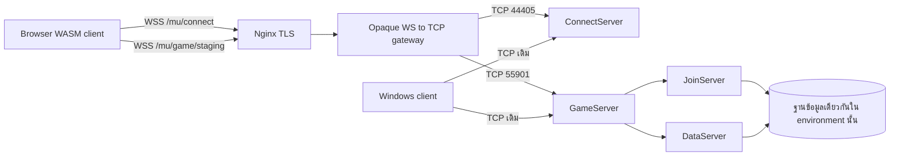

# MU Origins 0.97K: ผลตรวจซอร์สและต้นแบบเครือข่าย

วันที่ตรวจ: 19 ตุลาคม 2026 (Asia/Bangkok)

## ข้อสรุปและขอบเขตหลักฐาน

แนวทาง browser เล่นร่วมกับ Windows client มีความเป็นไปได้ทางสถาปัตยกรรม: ใช้ browser เป็น client ของ GameServer เดิม ผ่าน WSS-to-TCP gateway ที่ส่งไบต์เดิม และให้ GameServer/JoinServer/DataServer เป็นผู้ตัดสินข้อมูลทั้งหมด แต่ยังยืนยันว่าเล่นร่วมกับ MU Origins production ได้ไม่ได้ เพราะยังไม่มีหลักฐานว่า deployment จริงตรงกับซอร์สที่ตรวจ และยังไม่ได้ build/run WASM ที่แก้แล้วกับ GameServer จริง

ตรวจเส้นทาง network, encryption, login, redirect, session และ deployment ของทั้งสอง repository ลงมาถึง implementation ไม่ใช่อาศัย README อย่างเดียว ไม่ได้ตรวจทุก subsystem ของเกมหรือทำ security audit ทั้ง repository

ซอร์สที่ดาวน์โหลดและตรึงไว้:

| โครงการ | Commit ที่ตรวจ |
|---|---|
| Browser | `fb5d6aed769e6384a2f25164e75eded456307be7` |
| Mu-Linux | `fdfa008b4beb2905b9b0e144a7d6bb7713627766` |

บริบทแชตก่อนหน้าอ่านได้เฉพาะข้อความผู้ใช้; คำตอบ assistant ในข้อมูลที่เรียกกลับมาเป็น content-reference ไม่ใช่เนื้อหาคำตอบ จึงไม่ได้ใช้คำตอบเก่ามาเป็นหลักฐานทางเทคนิค

งานทั้งหมดอยู่ในเครื่องนี้ ไม่มีการเรียก login, เปิด socket ไป MU Origins, แตะ DNS, เปลี่ยน Nginx, deploy container หรือเขียนฐานข้อมูล production

## 1. ทำไมเปลี่ยน URL อย่างเดียวไม่ได้

Browser fork มี CNetwork, packet handlers, SimpleModulus, MuEmu และ ConnectServer flow อยู่แล้ว จึงไม่ต้องสร้าง protocol client ใหม่ทั้งหมด แต่เส้นทางเริ่มต้นถูกเปลี่ยนเพื่อเล่น solo:

| ไฟล์ใน browser repository | Function/บรรทัดของต้นฉบับ | สิ่งที่พบ |
|---|---|---|
| `src/client/browser/net_ws.cpp` | `mu_net_connect():145` | ปิด MuEmu, เรียก soloBridge, ตั้ง open และ FD_WRITE ทันที โดยไม่มี network connection |
| ไฟล์เดียวกัน | `mu_net_send():196` | ส่งเข้า worker แทน WebSocket |
| `web/app.js` | `initServerWorker():352`, `window.soloBridge:449` | สร้าง `server_worker.js`, แลก SEND_PACKET/PACKET_FROM_SERVER และจัดการ save ใน browser |
| `src/client/browser/shell_login.cpp` | `main():504` | โหลด config แล้วเขียนทับเป็น localhost:55901, ปิด ConnectServer และ MuEmu; ใส่สาม realm คงที่ |
| `src/client/src/Net/Recv/Recv_Account.cpp` | `Recv_JoinServer():37` | ส่ง HWID แล้ว login `solo/solo` อัตโนมัติ |
| `src/client/src/Config/Config_Load.cpp` | `Config_ReadServerAddr():335` | มีโค้ดเลือก CS/GS, สร้าง Version/Serial และ derive MuEmu keys อยู่แล้ว |

ดังนั้นต้นแบบใช้ `remote.html` แยกจากหน้า solo และไม่โหลด `app.js`/`server_worker.js` ใช้เฉพาะ WASM client ที่ rebuild พร้อม adapter ใหม่ ไม่รับ local save, inventory หรือ realm difficulty มาเป็นข้อมูลออนไลน์

อ้างอิงต้นฉบับ: [transport](https://github.com/andvolodko/mu-online-solo-classic/blob/fb5d6aed769e6384a2f25164e75eded456307be7/src/client/browser/net_ws.cpp#L145), [account flow](https://github.com/andvolodko/mu-online-solo-classic/blob/fb5d6aed769e6384a2f25164e75eded456307be7/src/client/src/Net/Recv/Recv_Account.cpp#L37)

## 2. สถาปัตยกรรมเป้าหมาย

หนึ่ง WebSocket ต่อหนึ่ง TCP connection ปลายทาง; ไม่ multiplex บัญชีหลายคนเข้า TCP socket เดียว เมื่อ CS ส่ง redirect client ปิด CS socket แล้วเปิด WSS ใหม่ไป GS route ผ่าน adapter mapping ที่กำหนดไว้ ไม่เปลี่ยน IP ในแพ็กเก็ตฝั่ง Windows

Gateway ไม่จำเป็นต้องเชื่อม JoinServer/DataServer/MySQL โดยตรง และไม่ควรเปิด daemons เหล่านี้สู่ browser

## 3. Packet framing และ TCP fragmentation

| Frame หลังถอด outer encryption | Length | Opcode | หมายเหตุ |
|---|---|---|---|
| C1 | byte 1, รวม header | byte 2 | ไม่มี SimpleModulus; client→GS ยังมี chain XOR |
| C2 | bytes 1–2, big endian, รวม header | byte 3 | frame ยาว |
| C3 | byte 1, รวม header | ต้อง decode body ก่อน | body มี serial + SimpleModulus ciphertext |
| C4 | bytes 1–2, big endian, รวม header | ต้อง decode body ก่อน | แบบยาวของ C3 |

TCP read หนึ่งครั้งอาจได้ครึ่ง header, หลาย packet หรือหนึ่ง packet กับต้น packet ถัดไป ส่วน WebSocket มี message boundary ของตัวเองซึ่งไม่ใช่ MU packet boundary ต้องสะสมไบต์ใน client parser ตาม length ห้ามสมมติว่า WS message = MU packet

Server: `Source/MuServer/GameServer/SocketManagerLinux.cpp::OnRecv():531` ถอด outer layer เฉพาะไบต์ใหม่ จากนั้น `DataRecv():207` รวม/แยก frame, decode C3/C4, ดึง serial, เรียก `CPacketManager::ExtractPacket()` แล้วส่ง queue ไป ProtocolCore

Client: `src/client/src/Scene/Scene_CharSelect_Nav.cpp::CWsctlc_nRecv():570` รับไบต์, ถอด MuEmu และแยก packet; `src/client/src/Net/Net_Process.cpp::Net_ProcessPacket()` decode C3/C4 แล้ว dispatch handler

พบ receive loop ของ client อาจอ่าน length ของ header ที่ยังมาไม่ครบหลังจบ packet ก่อนหน้า และไม่ได้ปฏิเสธ length เล็กเกิน header ต้นแบบมี guard ในแพตช์เพื่อรอ header ครบและปฏิเสธ length นอกช่วง 3/4..8192 แต่ยังไม่ได้ compile/execute native parser ที่แก้ การทดสอบ framing ที่ผ่านใช้ diagnostic parser JavaScript แยกต่างหาก จึงไม่ใช่ผลทดสอบ native parser

ฝั่ง server มีจุดที่ควรเพิ่ม regression test เช่น DataRecv อ่าน opcode ของ C2 ก่อนตรวจจำนวนไบต์ header ในแต่ละ iteration; รายงานนี้ไม่เปลี่ยน server code และยังไม่ได้พิสูจน์ผลกระทบ runtime ของกรณีนี้

ขอบเขตขนาดมีหลายชั้น: `MAX_MAIN_PACKET_SIZE=8192` แต่ `CPacketManager::AddData()` ปฏิเสธขนาด `>=2048` สำหรับข้อมูลที่นำเข้า ExtractPacket จึงห้ามตีความว่าทุก opcode รับ payload ได้ 8 KiB ต้นแบบกำหนด WS message 64 KiB เพื่อเป็น transport chunk เท่านั้น

## 4. Encryption: รักษาที่ client/server

Client→GameServer ตาม code ที่ตรวจ:

1. สร้าง plaintext opcode/payload; login account/password ใช้ argument XOR `{FC,CF,AB}` เฉพาะช่องละ 10 bytes
2. chain XOR ด้วยตาราง 32 bytes ใน `Network.cpp::XorKey` เริ่ม payload หลัง opcode (`SendFrameC1():310`, `SendFrameC3():337`)
3. สำหรับ C3/C4 ใส่ rolling packet serial แทน size byte ของ plaintext แล้วใช้ SimpleModulus block encoding (8 bytes → 11 bytes), สร้าง wire frame ใหม่
4. `SendRaw():245` ใช้ `MuEmu::EncryptSend()` กับทุกไบต์รวม header
5. ถ้า server เปิด MHP อีกชั้น ต้องมีการเข้ารหัสชั้นนั้นเพิ่มด้วย; adapter ปัจจุบันไม่ได้ทำให้โดยอัตโนมัติ

Server รับกลับในลำดับตรงข้าม: `HackCheck.cpp::DecryptData():15` → frame → `PacketManager.cpp::Decrypt():204` → serial → `ExtractPacket()/XorData():486` → protocol dispatch

GameServer→client: `SocketManagerLinux.cpp::DataSend():405` ใส่ serial/CSM ถ้าเป็น C3/C4 และใช้ EncryptData เมื่อ `ENCRYPT_STATE==1`; ไม่ควรเติม client→server chain XOR ลงในขารับแบบเหมารวม

`HackCheck.cpp::InitHackCheck():57` derive outer keys จาก CustomerName[32] และ ServerSerial[17] รวม zero padding; optional MHP ใช้ config เพิ่ม Browser `MuEmu.cpp::InitKeys()` มี base algorithm ที่สอดคล้องกัน แต่ไม่ได้พิสูจน์ production parameters หรือ optional MHP

ผลตรวจไฟล์ key จาก checkout ทั้งสองทิศทาง: modulus และ XOR ตรงกัน และ encryption/decryption multipliers เป็น modular inverses ครบทั้ง 4 ช่อง ตัว script ไม่พิมพ์เนื้อหา key ลงรายงาน ผลนี้เป็นการตรวจ algebra ของไฟล์ 54 bytes ไม่ใช่ native cipher round trip หรือผล login จริง

ตรวจ `PacketFrame.cpp` ตาราง 256 entries + subopcode overrides เทียบกับ `MuServer/Data/Hack/HackPacketCheck.txt` รวม 272 rows แล้วไม่พบ mismatch ใน snapshot นี้ หลักฐาน hashes และรายละเอียดอยู่ใน `source-evidence.json` ต้องทำซ้ำกับไฟล์ที่ deploy จริง

Gateway จึงส่ง opaque bytes ทั้งสองทิศทาง ห้ามตรวจ C1/C2/C3/C4 บน wire ที่ยังมี MuEmu เพราะแม้แต่ header ก็เข้ารหัสอยู่ `framing.mjs` เป็นเครื่องมือ offline หลังถอด outer layer เท่านั้น

อ้างอิง: [server packet manager](https://github.com/EmanuelCatania/Mu-Linux-0.97k/blob/fdfa008b4beb2905b9b0e144a7d6bb7713627766/Source/MuServer/GameServer/PacketManager.cpp), [outer encryption](https://github.com/EmanuelCatania/Mu-Linux-0.97k/blob/fdfa008b4beb2905b9b0e144a7d6bb7713627766/Source/MuServer/GameServer/HackCheck.cpp)

## 5. Server selection ที่ต้องรักษา

`Source/MuServer/ConnectServer/ConnectServerProtocol.cpp::ConnectServerProtocolCore():8` รับ F4/02 แล้วส่ง custom names ก่อน server list:

| ทิศทาง | Packet | Layout สำคัญ |
|---|---|---|
| CS→client | C1:00 | initial result; ไม่ใช่ GS F1/00 |
| client→CS | `C1 04 F4 02` | ขอรายชื่อ; ไม่มี chain XOR, CSM หรือ MuEmu |
| CS→client | C2:F4:04 | count HB/LB ที่ +5/+6, entries เริ่ม +7: WORD code + char name[32], stride 34 |
| CS→client | C2:F4:02 | count byte +5, entries เริ่ม +6: WORD code + BYTE load + padding, stride 4 ตาม ABI นี้ |
| client→CS | C1:F4:03 | ขอ address ของ code ที่เลือก |
| CS→client | C1:F4:03 | char IP[16] ที่ +4, WORD port LE ที่ +20, รวม 22 bytes |

`CCServerInfoRecv():101` จะไม่ส่ง redirect หาก JoinServer ไม่ active หรือ server entry ไม่ show/online การเห็นหน้ารายชื่อว่างจึงอาจเกิดจาก backend health ไม่ใช่ gateway

Client handlers จริงอยู่ใน `src/client/src/Net/Recv/Recv_Account.cpp` ไม่ใช่ function body ใน Net_Process ตามคอมเมนต์เก่าบางแห่ง: `Recv_CustomServerList():225`, `Recv_ServerList():250`, `Recv_Redirect():291`

ข้อแตกต่างจริงที่ต้องรู้: server request struct ใช้ BYTE ServerCode แต่ browser `Scene_ServerSelect_Input.cpp` ส่ง request 6 bytes รวม WORD code โค้ด server ปัจจุบันอ่านเฉพาะ low byte จึงพอใช้ได้สำหรับ code 0..255 แต่ยังไม่ใช่สัญญาที่ตรงกันสำหรับ code สูงกว่านั้น ให้ใช้ staging code ต่ำก่อนและกำหนด compatibility profile ก่อนแก้ทั้งสองฝั่ง

Redirect mapping ใน adapter เป็น `advertised-IP:port → fixed WSS path` เช่น `127.0.0.1:55901 → /mu/game/staging` ส่วน gateway map path ไป private TCP host เอง ไม่ส่ง host/port ที่ browser ระบุมาให้ gateway เชื่อถือ ไม่มี arbitrary TCP proxy และไม่ต้อง rewrite server list ที่ Windows client ใช้

## 6. Login และ sessions

GameServer ส่ง F1/00 ผ่าน `Protocol.cpp::GCConnectClientSend():1906`; ชื่อ handler ฝั่ง client เรียกว่า JoinServer แต่แพ็กเก็ตนี้มาจาก GS ไม่ใช่ browser ต่อ JoinServer โดยตรง

แพตช์เปลี่ยน `Recv_JoinServer()` ให้เข้าสถานะ CredentialInput และส่ง HWID; เลิก auto-login solo และเลิก retry password แบบคาดเดาจากโค้ดเดิม ส่วน `Game_SceneUpdate.cpp` รับการกด login แล้วเรียก `CNetwork::SendLogin()` ตามเดิม

F1/01 plaintext layout รวม 49 bytes:

| Offset | ขนาด | Field |
|---|---|---|
| 0..3 | 4 | header + F1 + 01 ก่อน wrap |
| 4 | 10 | account, argument XOR |
| 14 | 10 | password, argument XOR |
| 24 | 4 | TickCount LE |
| 28 | 5 | ClientVersion ที่ decode จาก internal Version[i] โดยลบ i+1 |
| 33 | 16 | ClientSerial |

`Config_ReadServerAddr()` แปลง `0.97.11` เป็น 5 bytes ก่อนสร้างค่า internal Version อย่าเดาว่าส่ง ASCII `0.97k` ลง wire และอย่าใช้ web account cookie แทน F1/01 โดยไม่มี SSO protocol ใหม่

`Source/MuServer/GameServer/Protocol.cpp::CGConnectAccountRecv():1161` ตรวจ connection state, blacklist, version/serial แล้ว `JSProtocol.cpp::GJConnectAccountSend():72` ส่งต่อ JoinServer; `Source/MuServer/JoinServer/JoinServerProtocol.cpp::GJConnectAccountRecv():87` ตรวจบัญชี/duplicate login และฐานข้อมูลตาม MD5Encryption mode; `GameServer/JSProtocol.cpp::JGConnectAccountRecv():89` ประมวลผลผลตอบกลับ

Packet serial เป็นสถานะต่อ connection: `SerialCheck.cpp::Init()` ตั้ง receive serial เป็น 255 เพื่อคาดหวัง 0 ครั้งแรก แล้วเพิ่มทีละหนึ่งแบบ byte; ห้ามแชร์ serial ระหว่าง CS/GS, หลาย browser tab หรือ replay packet หลัง reconnect

WebSocket ปิดต้องปิด TCP เพื่อให้ server cleanup session ตามปกติ การ reconnect คือสร้าง connection และ login ใหม่ ไม่ใช่ resume ciphertext stream เดิม Client `Net/Reconnect.cpp` มี retry flow และจำ credentials ใน memory; ยังต้องพิสูจน์การปล่อย account lock และ duplicate login กับ Windows client ด้วย staging tests

Browser HWID ใน `Net/HWID.cpp::HWID_Init()` เป็น random ID เก็บ localStorage จึงใช้แทน fingerprint ของ Windows ที่เชื่อถือได้ไม่ได้ ผู้ใช้ล้าง/เปลี่ยนได้ ไม่ควรใช้เป็นหลักฐาน anti-cheat

`GameServer/IpManager.cpp::CheckIpAddress():17` และ ConnectServer มี per-IP connection limit หลังผ่าน gateway ผู้เล่นทั้งหมดจะปรากฏเป็น IP gateway ห้ามเติม PROXY protocol หน้า MU stream เพราะ server นี้ไม่มี parser รองรับ ต้องกำหนด limit สำหรับ gateway IP ใน staging แล้วใช้ Nginx คุม real IP ที่ขอบระบบ; ยังต้องออกแบบ trusted source identity หากต้องรักษา ban/limit แบบเดิมใน production

ใน implementation นี้ MaxIpConnection=0 จะปฏิเสธ IP ใหม่ ไม่ได้แปลว่า unlimited จึงต้องอ่าน semantics ของ config ก่อนปรับค่า

## 7. สิ่งที่พัฒนาแล้ว

- `gateway.mjs`: fixed routes, exact Origin allowlist, binary only, TCP connect timeout, idle timeout, ping/pong cleanup, global/per-IP caps, message/rate/queue limits และ teardown ทั้งสองฝั่ง ไม่ log packet หรือ credentials
- `browser-adapter.mjs`: endpoint allowlist, รอ control message `{"type":"ready"}` หลัง TCP connect สำเร็จ, copy WASM memory ก่อน send, fresh HEAPU8 ตอนรับ, split delivery ทีละไม่เกิน 65536 และ generation guard กัน event จาก socket เก่ารบกวน socket ใหม่
- `browser-online.patch` และ `client-overlay/`: เปลี่ยน transport C++, คืน config/CS flow, เอา solo autologin และ static realms ออก, ปิด credential query parameters, เพิ่ม incomplete-header/invalid-length guards ฝั่ง client
- `remote.html`/`remote-fs.js`: หน้า staging desktop ขั้นต้น พร้อม filesystem path compatibility ของ upstream ไม่มี worker/save bridge หรือ mobile control UI
- `Dockerfile`, `compose.staging.yml`, `nginx.staging.conf`: ตัวอย่าง deployment แยก ใช้ staging hostname และ network แยกเท่านั้น
- `test/lab.test.mjs`, `audit-source.mjs`, `source-evidence.json`: ทดสอบและหลักฐานที่ทำซ้ำได้

Gateway ยอมให้ connection ของ GS เปิดตาม fixed route โดยตรง ไม่ผูกกับ CS session เพราะ legacy GS ต้องตรวจ login เอง หากต้องการบัตรผ่าน web/SSO ให้เพิ่ม ticket ที่ออกโดยระบบที่เชื่อถือได้, หมดอายุสั้นและใช้ได้ครั้งเดียวภายหลัง อย่าใส่ MU password ใน URL, localStorage หรือ logs Origin allowlist ไม่ใช่ authentication สำหรับ client ที่ปลอม HTTP headers เองได้

Queue เต็มใช้ fail-close เพื่อรักษา memory bound ยังไม่ใช่ระบบ pause/resume ที่ปรับจูนจากการวัด load; heartbeat, rate limits และ timeout เป็นค่าเริ่มต้นของ lab ต้องวัด traffic จริงก่อนนำใช้กับผู้เล่น

## 8. Docker, Nginx และ TLS

เริ่มที่ `playonline-staging.muorigins.online` หรือ hostname staging ที่ควบคุมได้ แล้วค่อยนำ pattern ที่พิสูจน์แล้วไป `playonline.muorigins.online` ภายหลัง ไม่เปลี่ยนหน้าเล่นหลักระหว่างทดลอง

Compose ที่ให้มาเป็นเฉพาะ gateway ไม่ใช่ stack MU ครบชุด ต้องสร้าง isolated MU stack อีกชุดพร้อม DB credentials, named volumes, data files และ server code ของ staging เอง ห้ามนำไปต่อ external network ของ production เพราะชื่อคล้ายกัน

Upstream `docker-compose.yml` เปิด TCP 44405/55901, UDP 55601 และใช้ database volume ของตน พร้อม web service อีกตัว ต้องใช้ Compose project name ใหม่ เปลี่ยน host-port binding ของ staging และแยก volume; ถ้าใช้ทดสอบ Windows บนเครื่องเดียว bind TCP เฉพาะ loopback ได้ ถ้าทดสอบคนละเครื่องใช้ private/VPN interface

ตัวอย่างของเราให้ gateway ฟังใน container และ bind host `127.0.0.1:18081`; Nginx อยู่ host และ reverse proxy ไปพอร์ตนี้ หาก Nginx อยู่ container ต้องแก้เป็น service DNS/network เดียวกัน เพราะ localhost ของ container ไม่ใช่ host

WSS ต้อง terminate TLS ด้วย certificate จริงและ DNS ที่ควบคุมได้ Nginx รักษา Upgrade/Connection/Origin, ปิด proxy buffering และตั้ง read timeout มากกว่ารอบ ping อย่า strip `/mu/` จาก upstream path ตัวอย่าง proxy_pass ไม่มี suffix จึงคง path

เมื่ออยู่หลัง Nginx gateway จะเห็น proxy IP เดียว: compose จึงตั้ง gateway per-IP cap เป็น 64 และให้ Nginx limit_conn 8 ต่อ client IP เป็นชั้นแรก ถ้ามี CDN เพิ่มต้องตั้ง trusted real-IP ranges อย่างถูกต้องก่อน มิฉะนั้นอาจรวมทุกคนเป็น IP เดียวอีก

Node image tag และ ws version ในต้นแบบเป็นค่าที่ใช้ build ตัวอย่าง มี package-lock สำหรับ dependency แต่ยังไม่ได้ตรวจช่องโหว่ล่าสุดหรือ pin image digest ก่อน production ให้ทำ dependency/image review และกำหนด immutable digest

Static hosting: serve `.wasm` เป็น `application/wasm`, ใช้ cache-busted artifacts ที่มาจาก build เดียวกัน และอย่า cache JS คนละรุ่นกับ WASM/data Emscripten build ปัจจุบันใช้ memory เริ่มต้น 512 MiB จึงต้องวัด desktop/mobile memory จริงด้วย COOP/COEP จำเป็นถ้าเปิด threads/SharedArrayBuffer ไม่ใช่เงื่อนไขของ WSS โดยตัวมันเอง

## 9. ผลตรวจที่ทำแล้วและข้อจำกัด

| การตรวจ | ผล |
|---|---|
| JS gateway/adapter tests บน Node v24.22.0 | ผ่าน 16/16 |
| Real WS↔TCP loopback และ JS adapter ร่วมกัน | ผ่าน; ส่ง bytes เท่าเดิม |
| split/coalesced TCP stream และ diagnostic C1–C4 parser | ผ่าน; ทุกตำแหน่งแบ่งแบบสองช่วงและส่งทีละ byte |
| origin/unknown route/query destination/text/oversize/rate/cap | ผ่านกรณีที่ระบุใน tests |
| client/server disconnect, TCP refusal | ผ่าน |
| stale callbacks, fresh heap, large delivery, send copy | ผ่าน |
| CSM key-file algebra สองทิศทาง | ผ่าน; ไม่ใช่ native crypto execution |
| frame-encryption policy 272 rows | ไม่พบ mismatch |
| git apply --check กับ browser commit ที่ตรึง | ผ่าน |
| native C++/Emscripten build, protocol static_assert execution | ยังไม่ทำ; ไม่พบ emcc ใน PATH ของ session |
| Docker build/Compose/Nginx config validation/TLS handshake | ยังไม่ทำ; ไม่พบ Docker CLI ใน PATH |
| browser renderer/login จริง/เล่นร่วม Windows/DB persistence | ยังไม่ทำ |
| production source/config parity, MHP, keys, latency/load | ยังไม่พิสูจน์ |

Native protocol header มี static_assert และ padding เฉพาะ fork แต่บาง comment อ้าง ancestor `25ceccb` และมีคำบรรยาย crypto ที่เก่า/คลาดเคลื่อน เช่น RC4-like ดังนั้นต้องเชื่อ implementation และทดสอบ wire capture ไม่ใช่ชื่อฟังก์ชันหรือ comment อย่างเดียว

สำคัญ: browser header มี GAMESERVER_EXTRA เช่น ViewCurHP/ViewDamageHP และ item width 7 bytes ในบาง packets; MU Origins ที่เป็น stock 0.97K หรือ custom build ต่างกันอาจ login ผ่านแต่ viewport/inventory/combat ผิดได้ ยังไม่ได้พิสูจน์ compatibility ทุก opcode หรือ data-table/asset parity

สำหรับ snapshot Mu-Linux ที่ตรวจ พบ `GameServer/stdafx.h` เปิด GAMESERVER_EXTRA=1 และ `ItemManager.h` กำหนด MAX_ITEM_INFO=7 ซึ่งสอดคล้องกับ browser header ที่ยกตัวอย่าง แต่ยังไม่ได้รัน ABI probes ของสอง build เทียบกัน และไม่ได้พิสูจน์ encoding ของ account/password ที่เป็น non-ASCII

## 10. ลำดับพิสูจน์ต่อโดยไม่กระทบ production

1. เก็บ manifest จาก deployment จริงแบบอ่านอย่างเดียว: source commit/build flags, Windows client Main/DLL version, config identity, hashes key files, HackPacketCheck, item/map definitions, optional MHP และ server list ไม่ต้องขอรหัสบัญชีผู้เล่น
2. สร้าง staging MU stack ด้วย DB ใหม่และบัญชีทดสอบใหม่ ห้าม restore production player data ไป lab โดยอัตโนมัติ เปิดเกม Windows ให้ login/create character/move/save ได้เป็น baseline ก่อน
3. ใช้ browser commit ที่ตรึง apply patch ตาม README ตั้ง ServerConfig ให้ตรง staging และ allowlist ให้ตรง advertised redirect แล้ว compile ทุก translation unit ที่เปลี่ยนและ link WASM ใหม่
4. เปิด remote.html จาก origin ที่อนุญาต เก็บผลเส้นทาง WSS→CS initial→F4/04→F4/02→F4/03→WSS GS→F1/00→HWID→manual F1/01 ห้ามบันทึก password/packet dump ที่มี credentials
5. ตรวจผล login ถูก/ผิด, version/serial ไม่ตรง, duplicate login บัญชีเดียวกับ Windows, logout/reconnect, tab close, upstream restart และ network loss ทั้งใน CS phase และ GS phase
6. ใช้สองบัญชี (browser/Windows) อยู่แผนที่เดียวกัน: เห็นกัน, movement/direction, chat, attack/damage/death, party, trade, inventory/item pickup/drop, teleport/map change และ warehouse จากนั้น relog ตรวจ DB persistence ไม่มี duplication
7. ทดสอบ boundary/fragmentation กับ native parser และ crypto ทั้งสองฝั่งโดยใช้ synthetic packets และ golden captures ของ staging; compile protocol probes ให้ sizeof/offset ตรง build จริง รวม C2/C4 และ packets ของ GAMESERVER_EXTRA
8. วัด concurrent sockets, backpressure, bandwidth, tick/latency, browser hidden-tab behavior, mobile memory และ gateway IP limits ปรับค่าตามหลักฐาน ไม่ลด anti-cheat/serial checks เพื่อให้ผ่าน
9. เมื่อผ่านทั้งหมด จึงเตรียมการเปลี่ยนเฉพาะ web hostname/route เป็นขั้นสุดท้าย เก็บ Windows TCP path เดิมและ rollback ด้วยการถอด browser route/หยุด gateway การตัด WS ต้องปล่อย session และ save ตาม backend ปกติ

ก่อน production ยังต้องมีผล build, staging acceptance และ configuration parity ที่กล่าวมา ต้นแบบนี้ยังไม่ใช่ client ที่เปิดให้ผู้เล่นใช้งานได้ทันที
